  

  
  

## 你好，我是陈逸潇

我一直跟着技术热点走，也承认自己有点投机。想走捷径的冲动，让我总忍不住把复杂问题做得更快、更省、更有效。AI（人工智能）正好放大了这种倾向：一边研究怎样用好它，加快获取信息、形成判断和推进工作；一边把它做进产品与工作流，看这些能力能不能走到用户采用和真实结果。对我来说，这两件事同样重要。

我也持续看实体商业。用户为什么付费、交易怎样发生、产品如何交付，会帮助我判断一项技术究竟解决了什么。

## 技术实践

### 让生成的广告素材被客户真正采用

在哔哩哔哩商业化参与广告标题、封面与视频 AIGC（人工智能生成内容）产品，负责对应模块的产品迭代、生成策略、线上问题归因和行业验证。通过填充预览和生成准入调整，推动客户综合点击意愿 +15%、端到端封面相对采纳 +20%；建立线上问题巡检与归因，问题率降至 2% 以下。同时参与视频知识拆解、Schema（结构规范）和分镜策略验证，把行业案例整理成模型可用的上下文。

### 给大模型内容总结定标准、做评测

在腾讯微信参与公众号内容总结场景的数据策略与评测，围绕事实忠诚度、覆盖度、可追溯性和可读性定义标准，参与数据采样、质检、引用规则、人工评测与问题归因。项目验收 20,000+ 问答对，初次训练后模型人工评测通过率约 +10%。

### 把商业素材生产做成一条工作流

围绕 Adobe Stock 的真实购买与审核环境，搭建选题、Prompt（提示词）、批量生成、超分、抠图和标签优化的完整流程，把单点生成变成可复用的流水线。累计上架 800+ 张素材，约 200 次销售，人效约 5 倍。

## 当前项目

- **[video-creative-agent](https://github.com/esmile-collab/video-creative-agent)**：把行业视频的脚本、画面与表达规律整理成 Agent（智能代理）可检索、组合与验证的上下文，目前处于知识资产和方法验证阶段。
- **[resume-agent](https://github.com/esmile-collab/resume-agent)**：简历与职位匹配工作台，把会话、评分、生成、局部修改、导出和过程记录接成一个完整流程。
- **个人知识系统**：持续整理阅读、对话和项目材料，保留来源与版本，让积累能参与后续判断。

## 联系

如果你也在做 AI 产品、评测或工作流相关的事，欢迎带着一个具体问题来聊：**你在解决什么、现在卡在哪里**。邮件 cyx791161473@outlook.com，或访问 [esmile.tech](https://esmile.tech)。
